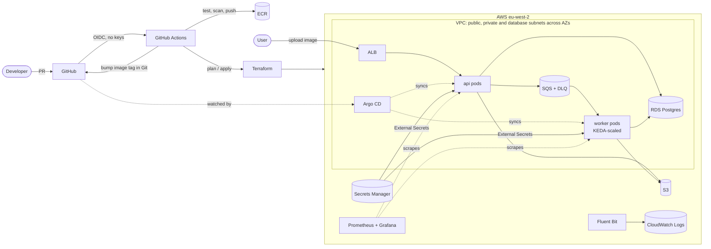

# pixelpipe-platform

A production-style AWS platform, built entirely with Terraform and run with GitOps, hosting a small image-thumbnail service.

[](https://github.com/YOUR_GITHUB_USER/YOUR_REPO/actions/workflows/app-ci.yml)
[](https://github.com/YOUR_GITHUB_USER/YOUR_REPO/actions/workflows/infra-ci.yml)

The app is deliberately small (about 10% of the work). The platform around it is the point: networking, Kubernetes, IAM, CI/CD, GitOps, observability, SLOs, security scanning, cost controls and operational docs.



**How a request flows:** a user uploads an image to the API. The API stores the original in S3, records it in Postgres and queues a job on SQS. A worker, scaled by KEDA on queue depth, turns it into a thumbnail.

## What this project demonstrates

| Skill area (from real 2026 cloud/platform job ads) | Where it lives |
|---|---|
| **Terraform**: own modules, multi-environment, remote state with S3 native locking, offline `terraform test` with mocked providers | `infra/` (bootstrap, 6 modules, `envs/dev` + `envs/prod`, `modules/environment/tests`) |
| **AWS networking**: 3-tier VPC, NAT strategy, VPC endpoints, flow logs | `infra/modules/vpc` and [ADR 0005](docs/adr/0005-network-design-and-nat.md) |
| **Kubernetes on EKS**: managed node groups (spot), access entries, managed add-ons, Pod Identity | `infra/modules/eks` |
| **Containers**: multi-stage, non-root, read-only rootfs, Trivy-scanned images | `apps/*/Dockerfile` |
| **CI/CD**: GitHub Actions with OIDC (zero stored AWS keys), plan comments on PRs, gated prod applies | `.github/workflows/` |
| **GitOps**: Argo CD app-of-apps, promotion by pull request | `gitops/`, [ADR 0002](docs/adr/0002-gitops-with-argocd.md) |
| **Helm**: one reusable "golden path" chart for every service | `charts/service` |
| **Security**: least-privilege IAM per pod, Secrets Manager + External Secrets, NetworkPolicies, KMS, Checkov, tflint | across the repo |
| **Observability**: Prometheus, Grafana dashboards as code, CloudWatch Logs, SLO burn-rate alerts with unit tests | `gitops/shared/observability`, `observability/tests` |
| **Autoscaling**: HPA (API) and KEDA on SQS depth, scaling to zero in dev (worker) | `gitops/envs/*/values` |
| **Reliability**: PDBs, topology spread, graceful shutdown, DLQ and retry semantics, runbooks, game days | `apps/worker`, `docs/runbooks`, `docs/game-days.md` |
| **Cost awareness**: budgets, spot, nightly teardown, Infracost, cost doc | `docs/cost.md` |
| **Python services** with unit and integration tests | `apps/api`, `apps/worker` |

## Quick start

### 1. Run it locally (no AWS needed)

```bash
docker compose up --build
curl -F "file=@some-photo.jpg" http://localhost:8080/v1/images      # -> {"id": "...", "status": "pending"}
curl http://localhost:8080/v1/images/<id>                            # -> "status": "done"
```

### 2. Deploy to AWS

The full walkthrough is in [docs/getting-started.md](docs/getting-started.md). The short version:

```bash
make configure                # fill in your GitHub repo, AWS account, IAM role
make bootstrap                # state bucket, GitHub OIDC roles, ECR, budget (once)
make github-vars              # wire GitHub Actions to AWS
git push                      # CI builds and pushes images, bumps tags in gitops/
make up ENV=dev               # ~20-25 min: VPC, EKS, RDS, add-ons, Argo CD
make status && make smoke     # see it running, run an end-to-end test
make down ENV=dev             # tear it all down when you're finished
```

> **Cost:** dev costs about **$0.30/hour** while it's up, roughly $200/month if left running. Build it, demo it, `make down`. See [docs/cost.md](docs/cost.md).

## Repository layout

```
apps/
  api/                 FastAPI service: upload -> S3 + Postgres + SQS
  worker/              SQS consumer: thumbnail -> S3, retries, DLQ semantics
charts/service/        Reusable Helm chart (Deployment, HPA/KEDA, PDB, NetworkPolicy, ServiceMonitor, alerts)
gitops/
  envs/dev|prod/       Argo CD Applications + per-env values (CI edits image tags here)
  shared/observability Grafana dashboards as code
infra/
  bootstrap/           State bucket, GitHub OIDC + CI roles, ECR, budget
  modules/             vpc, eks, rds-postgres, app-resources, platform-addons, environment
  envs/dev|prod/       Thin roots: one module call + env-specific sizing
observability/tests/   promtool unit tests for SLO alerts
loadtest/              k6 load test with SLO thresholds
scripts/               configure, teardown, smoke test, GitHub setup
docs/                  getting started, architecture, cost, ADRs, runbooks, game days, interview prep
```

## Environments

| | dev | prod |
|---|---|---|
| AZs / NAT gateways | 2 / 1 shared | 3 / 1 per AZ |
| VPC interface endpoints | none (cost) | ECR, STS, SQS, Secrets Manager, Logs |
| Nodes | 2 × spot (t3/m5 large) | 3 × on-demand (m5/m6i large) |
| RDS | db.t4g.micro, single-AZ, 1-day backups | db.t4g.small, Multi-AZ, 7-day backups, deletion protection |
| Worker scaling | KEDA 0 → 5 | KEDA 1 → 10 |
| Deploys | automatic on merge to `main` | `promote` workflow opens a PR; merge = deploy |
| Infra applies | automatic on merge | needs approval (GitHub environment reviewers) |

## Documentation

- [Getting started](docs/getting-started.md): zero to running, step by step
- [Architecture](docs/architecture.md): every component and why it's there
- [Cost](docs/cost.md): what it costs and how to keep it near zero
- [Architecture decision records](docs/adr/): EKS vs ECS, GitOps, OIDC, state layout, NAT, secrets, layering, KEDA
- [Runbooks](docs/runbooks/): what to do when each alert fires
- [Game days](docs/game-days.md): break it on purpose, then write a [postmortem](docs/postmortems/TEMPLATE.md)
- [Hardening backlog](docs/hardening.md): what a real production rollout would add next
- [Interview prep](docs/interview-prep.md): how to talk about this project

## Stretch goals

Karpenter for node autoscaling · Argo Rollouts canary releases · OpenTelemetry tracing · cert-manager + private CA · AWS WAF on the ALB · Kyverno policies · multi-region DR for the DB · Renovate for chart versions.
