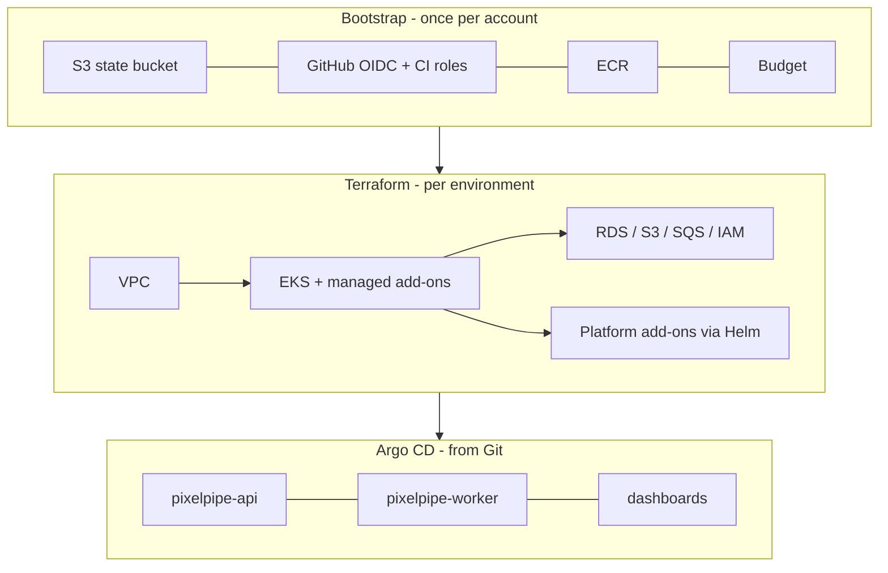
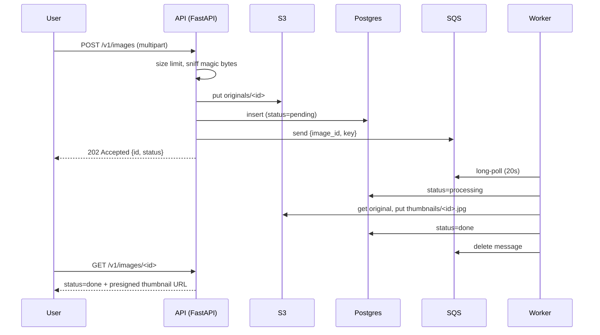
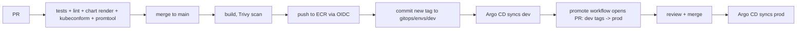

# Architecture

This page covers each layer of the platform, what it's built from and why. The decisions with real trade-offs have their own [ADRs](adr/).

## Layers

The boundary rule: **Terraform owns anything that needs AWS resources or IAM wired to it, plus the CRDs everything else depends on. Argo CD owns application workloads.** ([ADR 0007](adr/0007-terraform-vs-argocd-boundary.md))

Terraform hands its outputs to the apps through one contract: the `pixelpipe-infra` ConfigMap (bucket, queue URL, DB host…) and the `pixelpipe-db` Secret. The app chart has no environment-specific AWS identifiers in it at all.

## Network (`infra/modules/vpc`)

| Tier | Per-AZ CIDR (dev) | Route | Contains |
|---|---|---|---|
| public | /21 | Internet gateway | ALB, NAT gateway |
| private | /19 | NAT | EKS nodes and pods |
| database | /21 | none (local only) | RDS |

- Private subnets are the largest because the VPC CNI gives every pod a real VPC IP address.
- The database tier has **no route out** at all. RDS can't reach the internet even if misconfigured.
- An **S3 gateway endpoint** (free) keeps image pulls (ECR layers live in S3) and uploads off the NAT, which charges per GB.
- Prod adds **interface endpoints** for ECR, STS, SQS, Secrets Manager and Logs, so AWS API traffic stays private.
- **Flow logs** record REJECTed traffic only: the useful signal at a fraction of the cost.
- The default security group is locked to deny-all.

NAT: dev uses one shared NAT gateway, prod uses one per AZ. See [ADR 0005](adr/0005-network-design-and-nat.md).

## Kubernetes (`infra/modules/eks`)

- **Built from raw resources**, not a community module, so every role and add-on is visible.
- **Access entries** (`authentication_mode = "API"`) instead of the legacy `aws-auth` ConfigMap. Admins and the read-only CI plan role are listed explicitly. Terraform refuses to plan if whoever runs it wouldn't have access afterwards (a postcondition on `aws_iam_session_context`).
- **Managed add-ons**: VPC CNI (with the network policy agent switched on), kube-proxy, Pod Identity agent, CoreDNS, EBS CSI. Versions are resolved with `aws_eks_addon_version`. Ordering matters: networking add-ons go before the node group, CoreDNS and EBS CSI after.
- **Managed node group** on AL2023, spot in dev with four instance types for capacity diversity. Launch template enforces IMDSv2 and encrypted gp3 root volumes. Nodes have SSM for shell access, so there are no SSH keys.
- **Secrets envelope encryption** with a customer-managed KMS key that has rotation on.
- **`upgrade_policy = STANDARD`**: the cluster is upgraded automatically at end of standard support rather than silently moved onto extended support, which costs 6× more.

### Platform add-ons (`infra/modules/platform-addons`)

| Add-on | Why |
|---|---|
| AWS Load Balancer Controller | Turns the Ingress into an ALB using IP targets (traffic goes straight to pods). |
| External Secrets Operator | Syncs the RDS-managed password from Secrets Manager into a Kubernetes Secret. |
| KEDA | Scales the worker on SQS queue depth, down to zero in dev. |
| metrics-server | CPU metrics for the API's HPA. |
| kube-prometheus-stack | Prometheus, Alertmanager, Grafana, node-exporter, kube-state-metrics. EKS-managed control-plane scrapes are disabled to avoid permanent false alerts. |
| aws-for-fluent-bit | Ships container logs to CloudWatch Logs (retention set by Terraform). |
| ExternalDNS | Only when a Route 53 domain is configured. |
| Argo CD | GitOps. Its metrics are scraped too. |

All of them get AWS permissions via **EKS Pod Identity**, each role bound to exactly one namespace and service account. There are no node-wide permissions. See [ADR 0006](adr/0006-pod-identity-and-external-secrets.md).

## The application

Behaviours worth knowing (the code comments explain each one):

- **Liveness vs readiness:** `/healthz` doesn't touch the database, but `/readyz` does. A DB outage removes pods from the ALB instead of restart-looping every pod.
- **At-least-once delivery:** SQS can deliver twice, so processing is idempotent. A finished job is never moved back to `processing` or `failed`.
- **Poison messages:** a file that isn't a valid image is a permanent failure. It's marked failed and deleted, with no retries.
- **Transient failures** back off exponentially (`ChangeMessageVisibility`). After three receives SQS moves the message to the **DLQ**, and a CloudWatch alarm emails you.
- **Graceful shutdown:** on SIGTERM the worker finishes its batch and exits. Anything unfinished reappears on the queue.
- **Metrics labels use route templates** (`/v1/images/{image_id}`), never raw paths, to avoid a cardinality explosion.
- **Schema creation** takes a Postgres advisory lock, so pods starting at the same moment don't race.

## Delivery pipeline

- CI **never** has cluster credentials. It only pushes images and commits to Git.
- **Build once, promote the same image.** Prod gets the exact tag that ran in dev, not a rebuild.
- Infrastructure: PRs get `fmt`, `validate`, `terraform test` (mocked providers), tflint, Checkov and a real plan per environment as a PR comment. Merging applies dev; prod waits for approval.
- Daily drift detection runs `plan` against dev and opens an issue if someone changed something by hand.

## Observability

| Signal | Where | Notes |
|---|---|---|
| Metrics | Prometheus → Grafana | `ServiceMonitor`s come from the Helm chart. Dashboards are code in `gitops/shared/observability`. |
| Logs | Fluent Bit → CloudWatch Logs | Logs are JSON, so Logs Insights can filter by `level`, `image_id`, `request_id`. |
| SLO alerts | PrometheusRules (in each service's values) | Multi-window burn-rate alerts, unit-tested with `promtool test rules` in CI. |
| AWS alarms | CloudWatch → SNS email | DLQ not empty; oldest queued job older than 5 minutes. |

SLOs (API): **99.5% of requests succeed** and **p95 read latency under 500 ms**. Alerts link to [runbooks](runbooks/).

## Security controls (summary)

- No long-lived AWS credentials anywhere: humans use SSO, CI uses OIDC, pods use Pod Identity.
- Least-privilege IAM per workload: the API can only put into `originals/`, the worker can only write `thumbnails/`.
- DB password generated and rotatable by RDS, delivered by External Secrets, and never stored in Terraform state or Git.
- Containers run as non-root with a read-only root filesystem, all capabilities dropped and the seccomp RuntimeDefault profile.
- NetworkPolicies: default-deny ingress per service. Only Prometheus and in-VPC traffic (ALB IP targets, kubelet probes) are allowed.
- Encryption at rest everywhere: a customer-managed KMS key for EKS secrets, SSE-KMS for S3 and ECR, and encrypted RDS, SQS and EBS storage. TLS is enforced to S3 (bucket policy) and to Postgres (`rds.force_ssl`).
- Scanning: Trivy (images), Checkov and tflint (IaC), gitleaks (pre-commit). Dependabot keeps actions, pip, Docker and Terraform providers current.

See [hardening.md](hardening.md) for what's next.
